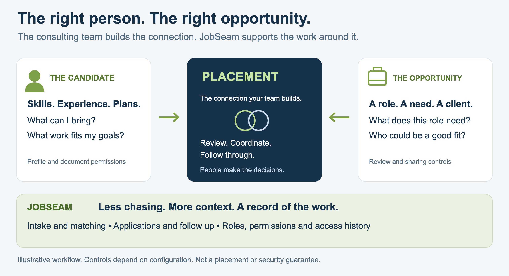
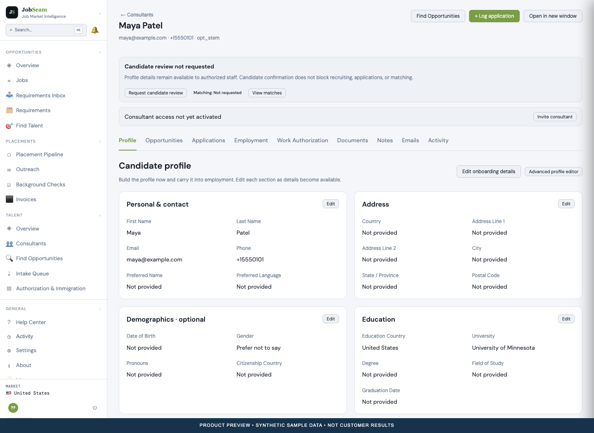
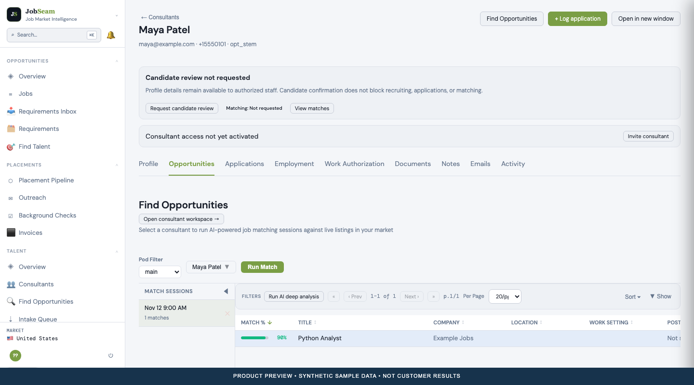
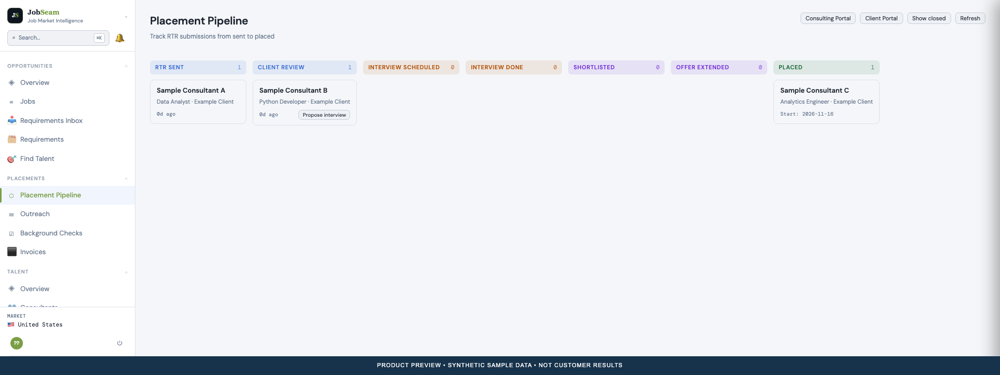
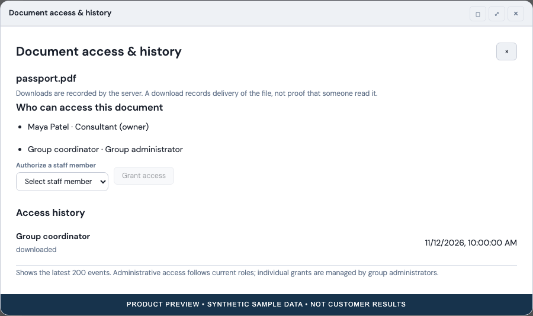

*By Quezaal Inc.*

A candidate has something to offer. An employer has a role to fill. Bringing them together takes more than finding the same skill on two pages.

Someone has to ask the next question. Confirm the details. Arrange the conversation. Get approval before a submission. Keep everyone informed when plans change.

For a staffing or consulting team, that work is part of the service. JobSeam gives it a shared home.

*An illustration of the workflow. Product screens below use synthetic sample data. They do not show real customers, actual placement outcomes or measured hiring results.*

## Two sides. One connection.

Start with the candidate. What can they do? What work do they want? When can they start? What details still need confirmation?

Now look at the opportunity. What does the client need? Where will the work happen? What are the expectations around pay, experience and availability?

A consulting team connects those two sets of needs. The placement is the result. The work around it deserves just as much attention.

## Start with what arrives.

A resume may arrive in an email. A recruiter may have a ZIP of resumes. A university team may have a roster. Someone else may want to enter the details directly.

JobSeam supports those starting points. Configured email and WhatsApp sources offer more ways to receive talent information. Incoming items can be reviewed before changes are accepted.

The source matters too. Keeping the sender, recipient and timestamps helps a team understand where a record came from.

## Give the person a place in the system.

A resume is useful. It is only part of the picture.

The consultant workspace brings profile details, preferences, applications, employment, documents and notes together. Staff can continue their work while the consultant reviews their details through a separate portal.

That keeps a profile useful as the relationship develops. It also gives the consultant a way to suggest corrections and upload requested documents.

*Actual JobSeam interface with sample data. The consultant workspace keeps the person's information and related work together.*

## Find a fit. Read the evidence.

Sometimes a client requirement comes first. Sometimes a consultant is ready for the next role.

JobSeam supports matching in both directions. Teams can review ranked results, skill gaps and resume evidence. Deeper AI analysis is available when requested.

A score starts a conversation. It does not replace one. A recruiter still needs to understand the person, the role and anything the data leaves unanswered.

*Sample match results in the actual interface. The displayed score is illustrative and is not a prediction of hiring success.*

## Make the next step visible.

After a promising match, there is still work to do.

Has the consultant agreed to be represented? Has the profile reached the client? Is an interview scheduled? Who needs to follow up?

JobSeam's placement pipeline follows submissions through review, interviews, offers and placement. Applications can record who acted on a consultant's behalf. Employment records, timesheets and invoices support the work that continues after placement.

*Sample submissions in the actual pipeline. These cards illustrate the workflow, not customer results or conversion rates.*

## Keep a record people can follow.

A team needs more than a current status. It needs context.

Who submitted the application? When was a document reviewed? Which invitation was attempted? What changed since the last conversation?

JobSeam records activity across its workflows. Invitation and intake emails can be previewed before sending, including recipients and CC/BCC. Send attempts have their own history. Provider acceptance does not prove that an email reached someone's inbox.

These records help people pick up the work without starting from memory.

## Be clear about access.

A resume and a passport should not be treated as interchangeable attachments.

JobSeam uses roles, group and Pod scope, and document permissions to control access. Document views include permission information and recorded access history. Consultants can see who is allowed to access a file and review recorded access information.

Those controls need careful configuration. They are part of handling information responsibly, not a promise that any system is risk free.

*The actual access dialog with sample data. The records shown do not represent a security audit or a complete record of activity outside JobSeam.*

## Let the system help. Keep people involved.

Software can help bring records in, extract details, rank matches and prepare documents. People still need to review the results.

JobSeam lets teams choose AI extraction, opportunity scanning and consultant invitations during resume intake. Other services depend on the providers and connections the team enables.

For teams managing work authorization, JobSeam also keeps authorization history, OPT/STEM OPT records and LCA/PAF preparation work connected. These are coordination and preparation tools. They do not determine legal eligibility or replace official filing channels and qualified advice.

## The connection is the point.

The candidate brings their skills and plans. The employer brings an opportunity. The consulting team brings the judgment and coordination needed to move forward.

JobSeam supports the work between them.

**The right person. The right opportunity. Every step connected.**

Want to see how your team would use it? Visit [jobseam.com](https://jobseam.com) or contact [connect@quezaal.com](mailto:connect@quezaal.com).

[Download the screenshot flyer](screenshot-flyer.pdf).

*Quezaal Inc. builds JobSeam and publishes this article. Screenshots show the implemented interface with synthetic test data captured November 12, 2026. Features depend on the deployed version, permissions, configuration and provider access. AI results and document drafts need human review. No placement, security or legal compliance outcome is guaranteed.*
