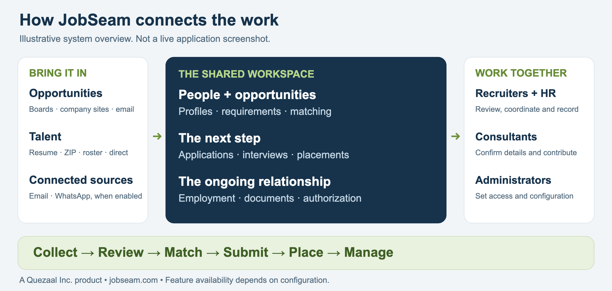

# JobSeam

**Find the fit. Keep the context. Move the work forward.**

Jobs, people and placements belong together. JobSeam connects them in one workspace, from the first resume to the next assignment.

For staffing and consulting firms, recruiting teams, employers, HR and university career services.

## Page 1: The story

### Start with what you have.

A resume, a roster or a requirement. There is a way to bring it in.

### Carry the context forward.

Keep the profile, the opportunity and the next step connected.

### Keep people in the loop.

Staff do the work. Consultants review their details. Decisions stay with people.

## Page 2: The capabilities

### Find the next opportunity.

Bring in jobs from supported boards, company sites and mailboxes. Review requirements. Filter the results. Explore the market. Search by role, skills, location, pay and work setting. Use dashboards and market drilldowns to explore the jobs your team has collected.

### Let talent come to you.

Resume, ZIP, roster or direct entry. Configured email and WhatsApp sources add more ways in. Review each item before accepting changes. Keep the source, sender, recipient and timestamps. Choose AI extraction, opportunity scanning and consultant invitations when uploading resumes.

### One person. One connected workspace.

Keep profiles, preferences, applications, employment and notes together. Invite consultants to review details, suggest corrections and upload documents. Capture contact, education and employee details as needed. Use university lists by country. Keep staff work moving while the consultant reviews their profile.

### Match both ways.

Find people for a requirement. Find opportunities for a person. Compare scores, resume evidence and skill gaps. Ask for deeper AI analysis when needed. Return to saved match sessions. Review the evidence behind a result. Recruiters make the decision; a score is a starting point.

### Keep the placement moving.

Track Right-to-Represent requests, submissions, interviews, offers and placements. See who applied on someone’s behalf. Continue into employment, timesheets and invoices. Use outreach templates, campaigns and participant portals. Screening and vendor management system workflows depend on the integrations your team enables.

### Keep authorization work organized.

Track authorization history and OPT/STEM OPT records. Prepare LCA records and PAF document drafts. Keep dates, evidence and review work connected. Record I-983 status, checkpoints and unemployment periods. Import LCA PDFs, review worksites and wages, and generate PDF/Word drafts from 12 PAF templates. Authorized admins control eligible public-file publication.

### Know who can see what.

Manage documents with access permissions, versions and recorded access history. Preview invitation emails, including recipients and CC/BCC. Track send attempts. Keep resumes, passports, EAD cards and other documents with the consultant. Consultants can review document access information in their portal.

### Make it work for your team.

Organize groups and Pods. Set roles, terminology and branding. Choose enabled markets, modules and sources. Review activity and collection runs. Self-hosted deployment and local AI model options support teams that want control of their environment. Availability follows your configuration and access.

**Bring your workflow. Let’s walk through it.**

[jobseam.com](https://jobseam.com) · [connect@quezaal.com](mailto:connect@quezaal.com)

*Based on implemented code reviewed November 12, 2026. Availability depends on roles, configuration and provider access. AI results and document drafts need human review. External services require activation and validation. JobSeam does not establish legal eligibility or compliance. Government e-filing, complete electronic I-9 execution and live IRS TIN matching are not established capabilities.*
